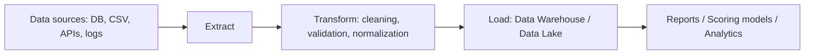
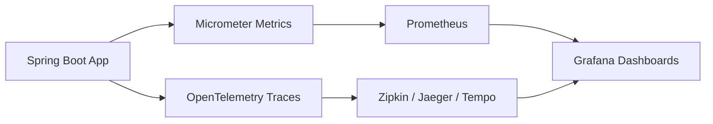
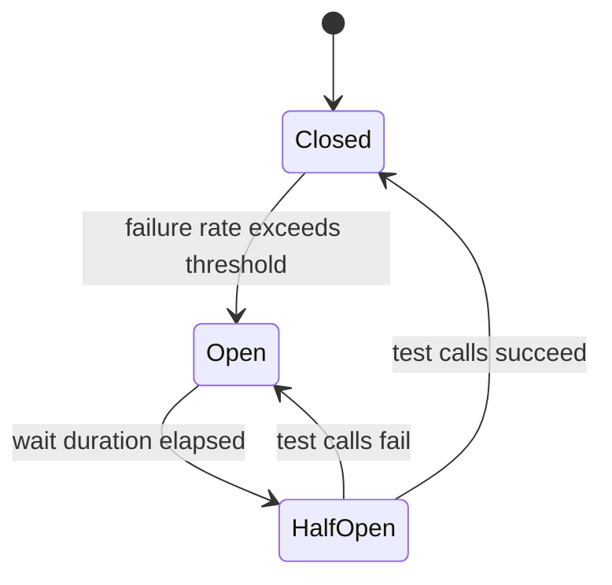
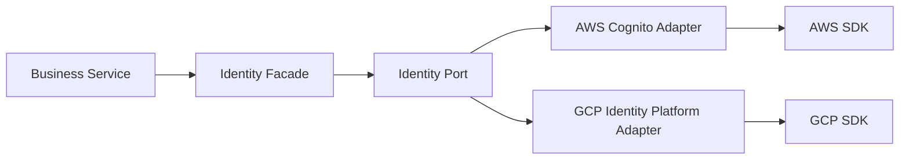
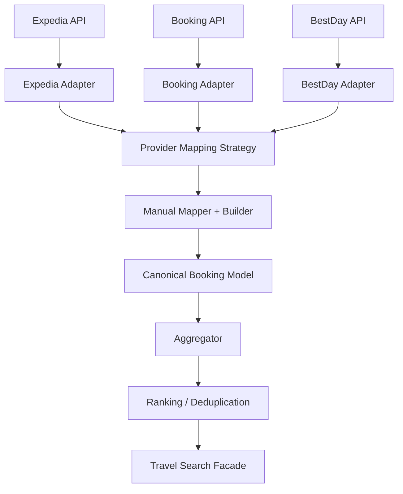
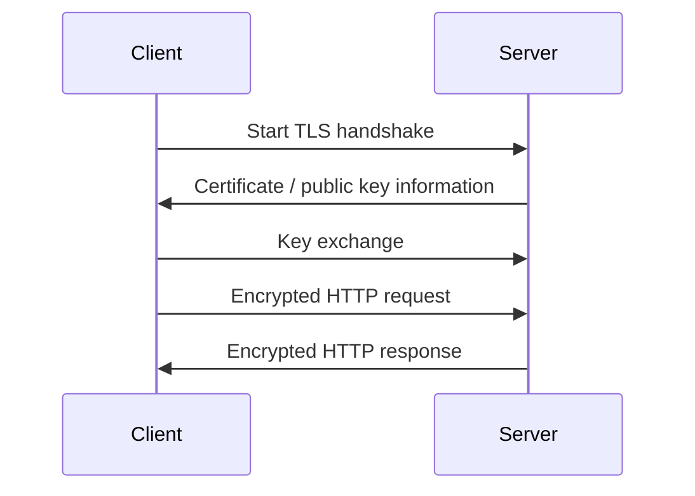
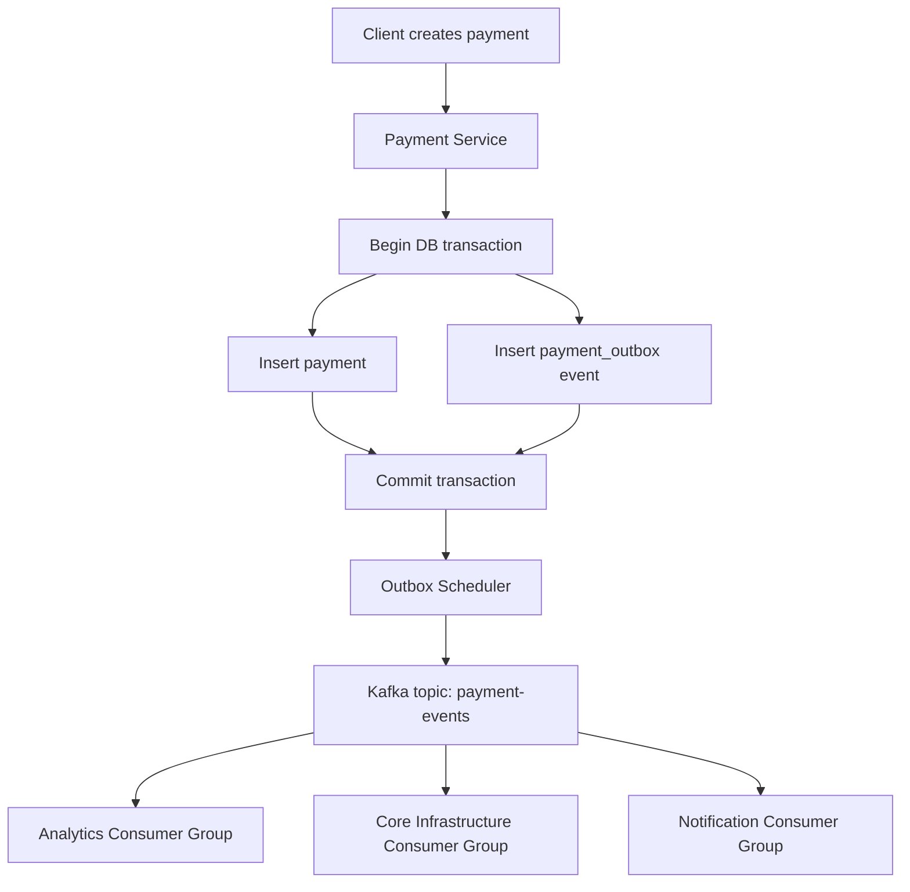
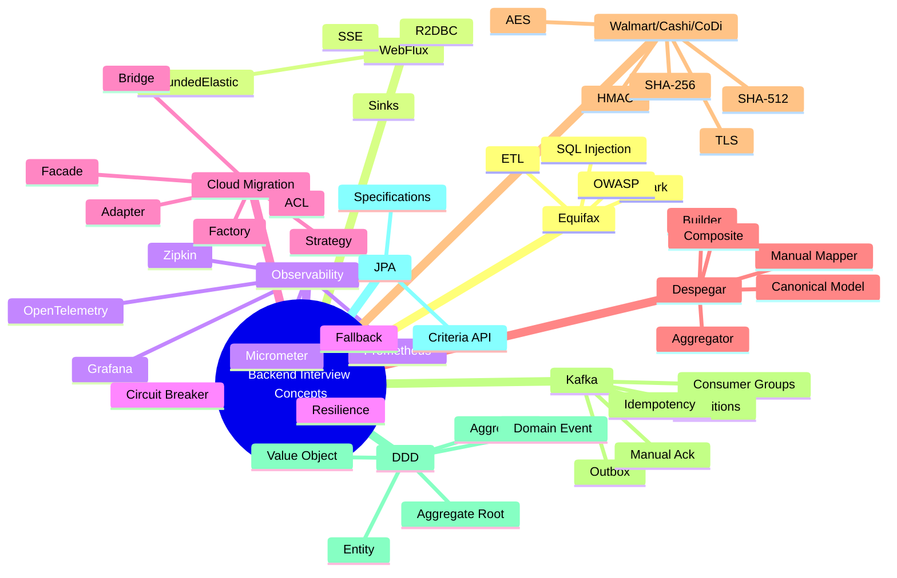

# Backend Interview Study Guide — English Edition

**Purpose:** prepare for backend interviews in English by reviewing concepts from real-world business scenarios inspired by **Equifax**, **Despegar.com**, **Walmart / Cashi / CoDi**, cloud migrations, Spring WebFlux, Kafka, Outbox Pattern, DDD, Spring Data JPA Criteria, security, observability, resilience, and design patterns.

> This guide is designed for Senior / Staff Backend interviews. The goal is not to memorize every sentence. The goal is to explain each concept clearly, connect it to a business case, and show that you understand the trade-offs.

---

## Table of Contents

1. [Equifax: ETL, Spark, SQL Injection and OWASP](#1-equifax-etl-spark-sql-injection-and-owasp)
2. [Spring WebFlux: Blocking Libraries, Schedulers, Sinks and SSE](#2-spring-webflux-blocking-libraries-schedulers-sinks-and-sse)
3. [Observability: Micrometer, Prometheus, Grafana, Zipkin and OpenTelemetry](#3-observability-micrometer-prometheus-grafana-zipkin-and-opentelemetry)
4. [Resilience: Circuit Breaker and Fallback Pattern](#4-resilience-circuit-breaker-and-fallback-pattern)
5. [AWS to GCP Migration: Design Patterns](#5-aws-to-gcp-migration-design-patterns)
6. [Despegar.com: Provider Integration and Data Normalization](#6-despegarcom-provider-integration-and-data-normalization)
7. [Walmart / Cashi / CoDi: Cryptography, HMAC, SHA and TLS](#7-walmart--cashi--codi-cryptography-hmac-sha-and-tls)
8. [Kafka, Outbox Pattern, Payments and Eventual Consistency](#8-kafka-outbox-pattern-payments-and-eventual-consistency)
9. [DDD: Entity, Value Object, Aggregate, Aggregate Root and Domain Events](#9-ddd-entity-value-object-aggregate-aggregate-root-and-domain-events)
10. [Spring Data JPA Criteria API and Specifications](#10-spring-data-jpa-criteria-api-and-specifications)
11. [Design Patterns Summary](#11-design-patterns-summary)
12. [Short Interview Answers](#12-short-interview-answers)
13. [Technical English Glossary](#13-technical-english-glossary)

---

# 1. Equifax: ETL, Spark, SQL Injection and OWASP

## 1.1 ETL Pipeline in a Batch Process

### Short definition

**ETL** means **Extract, Transform, Load**.

- **Extract:** read data from databases, APIs, CSV files, logs or legacy systems.
- **Transform:** clean, validate, enrich, normalize and apply business rules.
- **Load:** store the transformed data into a target system such as a Data Warehouse, Data Lake or analytical database.

A **batch process** does not usually run in real time. It processes large amounts of data in scheduled windows, for example every night at 2:00 AM.

### Business case: Equifax-style credit data pipeline

In a credit information company, a batch ETL pipeline could:

1. Read customer, loan, payment and delinquency information.
2. Remove duplicated or invalid records.
3. Normalize names, dates, amounts and statuses.
4. Calculate risk indicators.
5. Load the output into an analytical platform used for reporting or scoring models.

### Mermaid diagram



### Interview answer

> An ETL batch pipeline extracts data from multiple sources, transforms it by applying cleaning and business rules, and loads it into an analytical destination. It is useful when the company needs to process large volumes of information on a schedule instead of processing each event in real time.

---

## 1.2 Spark DataFrame vs Dataset

### DataFrame

A **DataFrame** is a distributed collection of data organized into named columns. It is similar to a SQL table.

Main points:

- Optimized by Spark Catalyst Optimizer.
- Easy to use for tabular transformations.
- Works well with SQL-like operations.
- Does not provide strong compile-time type safety.

### Dataset

A **Dataset** is a strongly typed distributed collection.

Main points:

- Provides type safety.
- Works with Java or Scala classes.
- Useful when transformations are more object-oriented.
- Can catch some errors at compile time.

### Interview answer

> In Spark, a DataFrame is like an optimized distributed table. A Dataset adds type safety by representing rows as typed objects. I would use DataFrames for SQL-like transformations and Datasets when I need compile-time type safety and domain-specific transformations.

---

## 1.3 SQL Injection

### Short definition

**SQL Injection** happens when user input is concatenated directly into a SQL query, allowing an attacker to modify the query logic.

### Bad example

```java
String sql = "SELECT * FROM users WHERE email = '" + email + "'";
```

If the user input contains malicious SQL, the query can be changed.

### Correct example with `PreparedStatement`

```java
String sql = "SELECT * FROM users WHERE email = ?";

try (PreparedStatement ps = connection.prepareStatement(sql)) {
    ps.setString(1, email);
    ResultSet rs = ps.executeQuery();
}
```

### Spring Data JPA example

```java
public interface UserRepository extends JpaRepository<UserEntity, Long> {

    @Query("select u from UserEntity u where u.email = :email")
    Optional<UserEntity> findByEmail(@Param("email") String email);
}
```

### How to prevent SQL Injection

- Use prepared statements.
- Use parameterized queries.
- Avoid string concatenation in SQL or JPQL.
- Validate user input.
- Use least privilege for database users.
- Use ORM correctly, but do not blindly trust dynamic queries.

### Interview answer

> I prevent SQL Injection by avoiding string concatenation and using prepared statements, parameterized queries or JPA parameters. I also validate input, restrict database permissions, and avoid exposing raw dynamic SQL when it is not necessary.

---

## 1.4 OWASP Top 10 for Backend

For backend interviews, the most important OWASP categories are usually:

### 1. Broken Access Control

A user can access resources or actions they should not access.

Backend examples:

- User A can read User B's payment.
- A normal user can call an admin endpoint.
- A client changes `userId` in the request and accesses another account.

How to prevent it:

- Validate authorization on every endpoint.
- Use role-based access control or permission-based access control.
- Never trust IDs sent by the client.
- Check ownership of resources.

### 2. Cryptographic Failures

Sensitive data is not protected correctly.

Backend examples:

- Storing passwords in plain text.
- Sending sensitive data over HTTP.
- Using weak algorithms.

How to prevent it:

- Use HTTPS/TLS.
- Use BCrypt or Argon2 for passwords.
- Encrypt sensitive data when required.
- Never store secrets in source code.

### 3. Injection

Untrusted input is interpreted as code or query logic.

Examples:

- SQL Injection.
- NoSQL Injection.
- Command Injection.

How to prevent it:

- Use prepared statements.
- Validate input.
- Avoid executing user input as commands.

### 4. Identification and Authentication Failures

Authentication is implemented incorrectly.

Examples:

- Weak password rules.
- Tokens without expiration.
- Session fixation.
- Missing MFA in sensitive flows.

How to prevent it:

- Use secure authentication frameworks.
- Use short-lived tokens.
- Rotate credentials.
- Protect login endpoints against brute force attacks.

### 5. Security Misconfiguration

The application or infrastructure is configured insecurely.

Examples:

- Exposing stack traces.
- Open CORS configuration.
- Debug endpoints enabled in production.
- Default credentials.

How to prevent it:

- Disable debug features in production.
- Use secure defaults.
- Configure CORS carefully.
- Keep dependencies updated.

### Interview answer

> In backend development, I apply OWASP by validating authorization at each endpoint, using parameterized queries to prevent injection, protecting sensitive data with TLS and proper hashing, configuring authentication securely, avoiding excessive error details, and keeping dependencies and infrastructure configuration under control.

---

# 2. Spring WebFlux: Blocking Libraries, Schedulers, Sinks and SSE

## 2.1 Blocking vs Non-blocking in WebFlux

### Short definition

Spring WebFlux uses a non-blocking execution model. It relies on a small number of event-loop threads. Those threads must not be blocked by slow operations such as JDBC, file I/O, synchronous HTTP clients or synchronous SDKs.

### Problem

If you call a blocking library directly from WebFlux, you block an event-loop thread. This reduces scalability and can cause performance issues under load.

### Interview answer

> In WebFlux, the problem is not whether a method returns `Mono` or `Flux`. The real problem is whether the internal operation blocks a thread. If a blocking call runs on the event loop, it can damage the scalability of the whole application.

---

## 2.2 JDBC vs R2DBC

### JDBC

JDBC is blocking.

```text
Request thread -> JDBC query -> wait for database -> response
```

The thread waits until the database returns a result.

### R2DBC

R2DBC is reactive and non-blocking.

```text
Request -> reactive database driver -> callback when data is available
```

### Best option

- Use **R2DBC** when you want a truly reactive database stack.
- Use **JDBC on boundedElastic** only as a migration or legacy bridge.

---

## 2.3 Wrapping JDBC with `boundedElastic`

### Important idea

Wrapping a blocking operation inside `Mono` does **not** make it truly reactive. It only allows you to move that blocking operation to a safer thread pool.

### Java example

```java
@Service
public class LegacyPaymentQueryService {

    private final JdbcTemplate jdbcTemplate;

    public LegacyPaymentQueryService(JdbcTemplate jdbcTemplate) {
        this.jdbcTemplate = jdbcTemplate;
    }

    public Mono<PaymentDto> findPaymentById(String paymentId) {
        return Mono.fromCallable(() ->
                jdbcTemplate.queryForObject(
                    "SELECT payment_id, amount, currency, status FROM payments WHERE payment_id = ?",
                    (rs, rowNum) -> new PaymentDto(
                            rs.getString("payment_id"),
                            rs.getBigDecimal("amount"),
                            rs.getString("currency"),
                            rs.getString("status")
                    ),
                    paymentId
                )
        ).subscribeOn(Schedulers.boundedElastic());
    }
}
```

### Interview answer

> If I have a blocking JDBC dependency in a WebFlux application, I can wrap it with `Mono.fromCallable()` and execute it on `Schedulers.boundedElastic()`. This does not make JDBC truly non-blocking, but it prevents the event-loop threads from being blocked. The best long-term solution is to migrate to R2DBC.

---

## 2.4 AWS SDK Sync vs AWS SDK Async

### Problem

Some SDK clients are synchronous. For example, a synchronous S3 client blocks until the file is downloaded or uploaded.

### Synchronous S3 wrapped with boundedElastic

```java
@Service
public class S3BlockingFileService {

    private final S3Client s3Client;

    public S3BlockingFileService(S3Client s3Client) {
        this.s3Client = s3Client;
    }

    public Mono<byte[]> downloadFile(String bucket, String key) {
        return Mono.fromCallable(() -> {
            ResponseBytes<GetObjectResponse> response = s3Client.getObjectAsBytes(
                    GetObjectRequest.builder()
                            .bucket(bucket)
                            .key(key)
                            .build()
            );
            return response.asByteArray();
        }).subscribeOn(Schedulers.boundedElastic());
    }
}
```

### AWS Async client with `Mono.fromFuture`

```java
@Service
public class S3AsyncFileService {

    private final S3AsyncClient s3AsyncClient;

    public S3AsyncFileService(S3AsyncClient s3AsyncClient) {
        this.s3AsyncClient = s3AsyncClient;
    }

    public Mono<byte[]> downloadFile(String bucket, String key) {
        CompletableFuture<ResponseBytes<GetObjectResponse>> future =
                s3AsyncClient.getObject(
                        GetObjectRequest.builder()
                                .bucket(bucket)
                                .key(key)
                                .build(),
                        AsyncResponseTransformer.toBytes()
                );

        return Mono.fromFuture(future)
                .map(ResponseBytes::asByteArray);
    }
}
```

### Interview answer

> If the SDK provides an async client, I prefer using it with `Mono.fromFuture()`. If I only have a blocking SDK, I wrap it with `Mono.fromCallable()` and execute it on `boundedElastic`. The async SDK is the cleaner long-term solution.

---

## 2.5 Schedulers vs Sinks

### Scheduler

A **Scheduler** decides where a task runs.

Example:

- `Schedulers.boundedElastic()` is useful for blocking operations.
- `Schedulers.parallel()` is useful for CPU-bound work.

### Sink

A **Sink** emits reactive events manually.

Use cases:

- Server-Sent Events.
- WebSockets.
- Streaming updates.
- Notifications.
- Kafka-to-Flux bridge.

### Simple rule

- **Scheduler:** controls execution threads.
- **Sink:** emits events into a reactive stream.

---

## 2.6 Server-Sent Events with Sinks

### Business case

A restaurant or catalog system wants to notify clients when product availability changes.

### Java example

```java
@Service
public class AvailabilityEventService {

    private final Sinks.Many<AvailabilityEvent> sink =
            Sinks.many().multicast().onBackpressureBuffer();

    public void publish(AvailabilityEvent event) {
        sink.tryEmitNext(event);
    }

    public Flux<AvailabilityEvent> stream() {
        return sink.asFlux();
    }
}
```

```java
@RestController
@RequestMapping("/availability")
public class AvailabilityController {

    private final AvailabilityEventService service;

    public AvailabilityController(AvailabilityEventService service) {
        this.service = service;
    }

    @GetMapping(value = "/events", produces = MediaType.TEXT_EVENT_STREAM_VALUE)
    public Flux<AvailabilityEvent> events() {
        return service.stream();
    }
}
```

### Interview answer

> I use `Sinks` when I need to manually emit events into a reactive stream, for example to expose Server-Sent Events. A Sink is not used to make blocking code reactive; that is the role of Schedulers.

---

# 3. Observability: Micrometer, Prometheus, Grafana, Zipkin and OpenTelemetry

## 3.1 Micrometer

Micrometer is an instrumentation facade used by Spring Boot to expose application metrics.

Examples:

- HTTP request count.
- Request latency.
- JVM memory.
- Error rate.
- Custom business metrics.

### Interview answer

> Micrometer is the instrumentation layer. It allows my Spring Boot application to expose metrics in a vendor-neutral way.

---

## 3.2 Prometheus

Prometheus stores time-series metrics.

It usually pulls metrics from the application endpoint:

```text
/actuator/prometheus
```

### Interview answer

> Prometheus collects and stores metrics over time. In a Spring Boot system, it can scrape metrics exposed by Micrometer through the actuator endpoint.

---

## 3.3 Grafana

Grafana visualizes metrics.

It does not usually collect metrics by itself. It reads from data sources such as Prometheus.

### Interview answer

> Grafana is the visualization layer. It reads metrics from Prometheus and displays dashboards for latency, throughput, memory, CPU and errors.

---

## 3.4 Zipkin

Zipkin is used for distributed tracing.

It helps answer:

- Which microservice was slow?
- Where did the request fail?
- How long did each step take?

### Interview answer

> Zipkin helps trace a request across multiple microservices and identify where latency or errors happen.

---

## 3.5 OpenTelemetry

OpenTelemetry is a standard for generating and exporting telemetry data:

- Metrics.
- Traces.
- Logs.

It can export data to tools like Prometheus, Zipkin, Jaeger, Grafana Tempo or commercial platforms.

### Mermaid diagram



### Interview answer

> Micrometer instruments metrics, Prometheus stores metrics, Grafana visualizes metrics, Zipkin traces distributed requests, and OpenTelemetry provides a standard way to collect and export metrics, traces and logs.

---

# 4. Resilience: Circuit Breaker and Fallback Pattern

## 4.1 Circuit Breaker

A Circuit Breaker prevents an application from repeatedly calling a failing dependency.

### States

#### Closed

Normal state. Requests are allowed to pass.

#### Open

The dependency is considered unhealthy. Requests are not sent to the dependency and the application returns a fallback response or controlled error.

#### Half-Open

After a wait time, a limited number of test requests are allowed. If they succeed, the circuit closes again. If they fail, the circuit opens again.

### Mermaid diagram



---

## 4.2 Fallback Pattern

A fallback is an alternative response when the main dependency fails.

Examples:

- Return cached data.
- Return partial data.
- Return a controlled unavailable response.
- Use a secondary provider.

### Java example with Resilience4j

```java
@Service
public class HotelAvailabilityService {

    private final ProviderClient providerClient;

    public HotelAvailabilityService(ProviderClient providerClient) {
        this.providerClient = providerClient;
    }

    @CircuitBreaker(name = "providerAvailability", fallbackMethod = "fallbackAvailability")
    public List<HotelAvailability> getAvailability(String destination) {
        return providerClient.search(destination);
    }

    public List<HotelAvailability> fallbackAvailability(String destination, Throwable error) {
        return List.of();
    }
}
```

### Interview answer

> I use Circuit Breaker to avoid cascading failures. If a provider starts failing, the circuit opens and the application stops calling it temporarily. During that time, I can return a fallback response such as cached data, partial data or a controlled error.

---

# 5. AWS to GCP Migration: Design Patterns

## 5.1 Business case

A system currently uses AWS services such as:

- AWS Cognito for identity.
- AWS SDK for integrations.
- A database or AWS-specific storage.

The company wants to migrate to GCP services such as:

- Google Identity Platform.
- Cloud Spanner.
- GCP SDKs.

The challenge is not only technical. The real problem is that each provider has a different model and philosophy.

---

## 5.2 Recommended patterns

### Strategy Pattern

Use Strategy when the implementation can change depending on provider or configuration.

```java
public interface IdentityProviderStrategy {
    AuthenticatedUser authenticate(LoginRequest request);
}
```

```java
@Component("awsCognito")
public class CognitoIdentityStrategy implements IdentityProviderStrategy {
    @Override
    public AuthenticatedUser authenticate(LoginRequest request) {
        // Call Cognito SDK
        return new AuthenticatedUser("user-123", "AWS_COGNITO");
    }
}
```

```java
@Component("gcpIdentity")
public class GcpIdentityPlatformStrategy implements IdentityProviderStrategy {
    @Override
    public AuthenticatedUser authenticate(LoginRequest request) {
        // Call Google Identity Platform
        return new AuthenticatedUser("user-123", "GCP_IDENTITY_PLATFORM");
    }
}
```

### Adapter Pattern

Use Adapter to translate a provider-specific SDK into your internal contract.

```java
public interface UserIdentityPort {
    UserIdentity findByExternalId(String externalId);
}
```

```java
@Component
public class CognitoUserIdentityAdapter implements UserIdentityPort {
    @Override
    public UserIdentity findByExternalId(String externalId) {
        // Translate Cognito response into internal UserIdentity
        return new UserIdentity(externalId, "email@example.com");
    }
}
```

### Bridge Pattern

Bridge separates the abstraction from the implementation, allowing both to evolve independently.

Example:

```text
IdentityService abstraction
    can work with
CloudIdentityProvider implementation
```

This is useful when you have multiple domains and multiple providers.

### Factory Pattern

Factory selects the correct implementation.

```java
@Component
public class CloudProviderFactory {

    private final Map<String, IdentityProviderStrategy> strategies;

    public CloudProviderFactory(Map<String, IdentityProviderStrategy> strategies) {
        this.strategies = strategies;
    }

    public IdentityProviderStrategy identityProvider(String provider) {
        return strategies.get(provider);
    }
}
```

### Facade Pattern

Facade exposes a simple API and hides SDK complexity.

```java
@Service
public class IdentityFacade {

    private final CloudProviderFactory factory;

    public IdentityFacade(CloudProviderFactory factory) {
        this.factory = factory;
    }

    public AuthenticatedUser login(String provider, LoginRequest request) {
        return factory.identityProvider(provider).authenticate(request);
    }
}
```

### Anti-Corruption Layer

An Anti-Corruption Layer prevents cloud-specific models from contaminating the domain.

Bad design:

```text
Business service depends directly on CognitoUserResponse
```

Good design:

```text
Business service depends on UserIdentity
Adapter translates CognitoUserResponse into UserIdentity
```

### Mermaid diagram



### Interview answer

> For a cloud migration from AWS to GCP, I would isolate the domain from the provider using interfaces, adapters and an anti-corruption layer. I would use Strategy or Factory to choose between AWS and GCP implementations, Facade to hide SDK complexity, and Bridge when I need to separate business abstractions from cloud implementations.

---

# 6. Despegar.com: Provider Integration and Data Normalization

## 6.1 Business case

Imagine a travel platform that consumes multiple providers:

- Expedia.
- Booking.com.
- BestDay.
- Despegar.
- Other hotel or travel platforms.

Each provider has a different API contract.

The company needs to normalize all provider responses into a single internal business model such as:

```text
Booking
Hotel
Room
Rate
CancellationPolicy
PaymentPolicy
TravelPackage
```

---

## 6.2 Recommended architecture



---

## 6.3 Aggregator Pattern

The Aggregator coordinates multiple provider calls and returns a unified response.

### Responsibilities

- Call multiple providers.
- Combine results.
- Remove duplicates.
- Sort by price, rating, availability or business priority.
- Return a unified response.

### What the Aggregator should not do

The Aggregator should not become a giant class containing all provider-specific rules.

Better design:

```text
Provider-specific logic -> Adapter / Strategy / Normalizer
Coordination logic -> Aggregator
```

---

## 6.4 Adapter Pattern

Each provider gets its own adapter.

```java
public interface TravelProviderAdapter {
    ProviderCode provider();
    List<ProviderHotelResponse> search(SearchRequest request);
}
```

```java
@Component
public class ExpediaAdapter implements TravelProviderAdapter {

    @Override
    public ProviderCode provider() {
        return ProviderCode.EXPEDIA;
    }

    @Override
    public List<ProviderHotelResponse> search(SearchRequest request) {
        // Call Expedia API and return provider-specific DTOs
        return List.of();
    }
}
```

---

## 6.5 Strategy Pattern for provider normalization

The real variation is not the mapping tool. The real variation is the provider-specific behavior.

Good strategy design:

```text
ExpediaBookingMappingStrategy
BookingComMappingStrategy
BestDayMappingStrategy
```

Not ideal as the main design:

```text
MapStructStrategy
ManualMapperStrategy
ObjectMapperStrategy
```

### Java interface

```java
public interface BookingMappingStrategy<T> {
    ProviderCode provider();
    CanonicalBooking toCanonical(T providerResponse);
}
```

### Manual mapper with Builder

```java
@Component
public class ExpediaBookingMappingStrategy implements BookingMappingStrategy<ExpediaHotelResponse> {

    private final CurrencyNormalizer currencyNormalizer;
    private final CancellationPolicyNormalizer policyNormalizer;

    public ExpediaBookingMappingStrategy(
            CurrencyNormalizer currencyNormalizer,
            CancellationPolicyNormalizer policyNormalizer
    ) {
        this.currencyNormalizer = currencyNormalizer;
        this.policyNormalizer = policyNormalizer;
    }

    @Override
    public ProviderCode provider() {
        return ProviderCode.EXPEDIA;
    }

    @Override
    public CanonicalBooking toCanonical(ExpediaHotelResponse response) {
        return CanonicalBooking.builder()
                .provider(ProviderCode.EXPEDIA)
                .externalId(response.hotelId())
                .hotelName(response.hotelName())
                .checkIn(response.checkIn())
                .checkOut(response.checkOut())
                .totalPrice(currencyNormalizer.toDefaultCurrency(response.price(), response.currency()))
                .currency("MXN")
                .cancellationPolicy(policyNormalizer.normalize(response.cancellationRules()))
                .build();
    }
}
```

---

## 6.6 Manual Mapper vs MapStruct vs Jackson ObjectMapper

### Jackson ObjectMapper

Use it for:

- JSON to DTO.
- DTO to JSON.
- Serialization.
- Deserialization.

Do not use it as the main business normalizer.

### MapStruct

Use it when:

- Objects are structurally similar.
- The mapping is repetitive.
- There are few business rules.
- You want compile-time generated mapping code.

### Manual Mapper with Builder

Use it when:

- Provider domains are very different.
- There are many conditions.
- There are fallback fields.
- You need currency conversion.
- You need tax normalization.
- You need cancellation policy normalization.
- You need timezone conversion.

### Honest recommendation for Despegar.com-style integrations

For external travel providers with very different models, use **manual mappers with Builder** for the canonical business model.

MapStruct can still be used for simple structural mappings, but if it requires too many expressions, conditions and exceptions, it becomes harder to maintain than explicit Java code.

### Interview answer

> I would use Jackson for JSON serialization and deserialization, MapStruct for simple structural mappings, and manual mappers with Builder for complex business normalization. In a provider integration scenario like Expedia or Booking, I prefer explicit manual mapping because the domains are different and the transformation includes business meaning, not just field copying.

---

## 6.7 Canonical Data Model

A **Canonical Data Model** is the internal business model that all providers are converted into.

Example:

```java
@Builder
public record CanonicalBooking(
        ProviderCode provider,
        String externalId,
        String hotelName,
        LocalDate checkIn,
        LocalDate checkOut,
        BigDecimal totalPrice,
        String currency,
        CancellationPolicy cancellationPolicy
) {}
```

### Interview answer

> A canonical model allows the company to work with a single internal representation, even if each external provider has a different API contract.

---

## 6.8 Chain of Responsibility

Use it when normalization has multiple independent steps.

Example steps:

1. Validate required fields.
2. Normalize dates.
3. Normalize currency.
4. Normalize taxes.
5. Normalize cancellation policies.
6. Remove duplicates.

### Java example

```java
public interface BookingNormalizationStep {
    CanonicalBooking apply(CanonicalBooking booking);
}
```

```java
@Component
public class CurrencyNormalizationStep implements BookingNormalizationStep {
    @Override
    public CanonicalBooking apply(CanonicalBooking booking) {
        // Return a new booking with normalized currency
        return booking;
    }
}
```

```java
@Service
public class BookingNormalizationPipeline {

    private final List<BookingNormalizationStep> steps;

    public BookingNormalizationPipeline(List<BookingNormalizationStep> steps) {
        this.steps = steps;
    }

    public CanonicalBooking normalize(CanonicalBooking booking) {
        CanonicalBooking current = booking;
        for (BookingNormalizationStep step : steps) {
            current = step.apply(current);
        }
        return current;
    }
}
```

---

## 6.9 Composite Pattern

Use Composite when a travel product can be simple or composed.

Example:

```text
TravelPackage
 ├── Hotel
 ├── Flight
 ├── CarRental
 └── Insurance
```

### Java example

```java
public interface TravelProduct {
    BigDecimal totalPrice();
}
```

```java
public class HotelProduct implements TravelProduct {
    private final BigDecimal price;

    public HotelProduct(BigDecimal price) {
        this.price = price;
    }

    @Override
    public BigDecimal totalPrice() {
        return price;
    }
}
```

```java
public class TravelPackage implements TravelProduct {
    private final List<TravelProduct> products;

    public TravelPackage(List<TravelProduct> products) {
        this.products = products;
    }

    @Override
    public BigDecimal totalPrice() {
        return products.stream()
                .map(TravelProduct::totalPrice)
                .reduce(BigDecimal.ZERO, BigDecimal::add);
    }
}
```

### Interview answer

> Composite is useful when a booking can be a single product or a package composed of hotel, flight, car rental and insurance, while the system still wants to treat both as a travel product.

---

# 7. Walmart / Cashi / CoDi: Cryptography, HMAC, SHA and TLS

## 7.1 Symmetric Cryptography

Symmetric cryptography uses the same secret key to encrypt and decrypt data.

Examples:

- AES.
- ChaCha20.

### Advantages

- Fast.
- Good for large amounts of data.

### Disadvantage

- The secret key must be shared securely.

### Interview answer

> Symmetric cryptography uses the same key for encryption and decryption. It is fast and commonly used to protect data after a secure key has been established.

---

## 7.2 Asymmetric Cryptography

Asymmetric cryptography uses a key pair:

- Public key.
- Private key.

What is encrypted with one key can be decrypted with the other, depending on the use case.

Examples:

- RSA.
- ECC.
- ECDSA.

### Use cases

- Secure key exchange.
- Digital signatures.
- Certificate-based authentication.

### Interview answer

> Asymmetric cryptography uses public and private keys. It is slower than symmetric cryptography, but it is useful for key exchange, digital signatures and authentication.

---

## 7.3 SHA-256 and SHA-512

SHA is a family of cryptographic hash functions.

- **SHA-256:** produces a 256-bit hash.
- **SHA-512:** produces a 512-bit hash.

A hash is not encryption.

You cannot decrypt a hash.

### Use cases

- Integrity checks.
- Digital signatures.
- HMAC.
- Password hashing only when combined with proper password-specific algorithms such as BCrypt, Argon2 or PBKDF2. Do not use plain SHA for passwords.

### Interview answer

> SHA-256 and SHA-512 are hash functions. They generate a fixed-size fingerprint of input data. They are one-way functions, so they do not encrypt data and cannot be decrypted.

---

## 7.4 HMAC

HMAC means **Hash-based Message Authentication Code**.

It combines:

```text
message + secret key + hash function
```

Example:

```text
HMAC-SHA256(message, secretKey)
```

### What HMAC provides

- Integrity: the message was not modified.
- Authenticity: the sender knows the shared secret.

### What HMAC does not provide

- It does not hide the message.
- It does not encrypt the payload.

### Java example

```java
public class HmacSigner {

    public static String hmacSha256(String message, String secret) throws Exception {
        Mac mac = Mac.getInstance("HmacSHA256");
        SecretKeySpec keySpec = new SecretKeySpec(secret.getBytes(StandardCharsets.UTF_8), "HmacSHA256");
        mac.init(keySpec);
        byte[] signature = mac.doFinal(message.getBytes(StandardCharsets.UTF_8));
        return Base64.getEncoder().encodeToString(signature);
    }
}
```

### Interview answer

> HMAC is not asymmetric encryption. HMAC uses a shared secret key and a hash function to verify integrity and authenticity. It proves that the message was not modified and that the sender knows the secret key, but it does not encrypt the message.

---

## 7.5 TLS vs SSL

SSL is the old protocol and is obsolete.

TLS is the modern protocol used by HTTPS.

TLS protects the communication channel between client and server.

### How TLS works conceptually

1. The client connects to the server.
2. The server presents a certificate.
3. Asymmetric cryptography is used during negotiation.
4. A shared symmetric key is established.
5. Data is encrypted using symmetric encryption because it is faster.

### Mermaid diagram



### Difference between HMAC and encryption

| Concept | Main goal | Does it hide data? | Uses key? |
|---|---|---:|---:|
| Encryption | Confidentiality | Yes | Yes |
| Hash | Integrity fingerprint | No | No |
| HMAC | Integrity + authenticity | No | Yes, shared secret |
| TLS | Secure transport channel | Yes | Yes |

### Interview answer

> TLS protects the communication channel. HMAC protects the message integrity and authenticity. Encryption hides data, while HMAC does not hide the payload; it only verifies that the message was not modified and that it came from someone who knows the shared secret.

---

# 8. Kafka, Outbox Pattern, Payments and Eventual Consistency

## 8.1 Business case

A user makes a payment in a payment service. Other microservices need to react asynchronously:

- Analytics service.
- Core infrastructure service.
- Notification service.
- Fraud or risk service.

The problem is that the database transaction and Kafka publication are two different systems. If the payment is saved but Kafka publication fails, the system becomes inconsistent.

The **Outbox Pattern** solves this by saving the business entity and the event in the same database transaction.

---

## 8.2 Outbox Pattern

### Short definition

Outbox Pattern stores events in an outbox table inside the same database transaction as the business change. A scheduler or publisher later reads the outbox table and publishes events to Kafka.

### Mermaid diagram



### Interview answer

> The Outbox Pattern guarantees that the business change and the event record are committed atomically in the same database transaction. Kafka publication happens later, but the event cannot be lost because it is stored in the database first.

---

## 8.3 Payment table

The `payments` table represents the business state.

Example structure:

```sql
CREATE TABLE payments (
    payment_id      VARCHAR(64) PRIMARY KEY,
    user_id         VARCHAR(64) NOT NULL,
    amount          DECIMAL(18, 2) NOT NULL,
    currency        VARCHAR(3) NOT NULL,
    status          VARCHAR(32) NOT NULL,
    idempotency_key VARCHAR(128) UNIQUE NOT NULL,
    created_at      TIMESTAMP NOT NULL,
    updated_at      TIMESTAMP NOT NULL
);
```

### Important fields

- `payment_id`: unique payment identifier.
- `user_id`: customer or wallet owner.
- `amount`: payment amount.
- `currency`: currency code, for example MXN.
- `status`: current payment status.
- `idempotency_key`: prevents duplicate payments if the client retries.
- `created_at` and `updated_at`: auditing information.

---

## 8.4 Payment outbox table

The `payment_outbox` table represents pending integration events.

```sql
CREATE TABLE payment_outbox (
    event_id        VARCHAR(64) PRIMARY KEY,
    aggregate_id    VARCHAR(64) NOT NULL,
    aggregate_type  VARCHAR(64) NOT NULL,
    event_type      VARCHAR(64) NOT NULL,
    payload         JSONB NOT NULL,
    status          VARCHAR(32) NOT NULL,
    retry_count     INT NOT NULL DEFAULT 0,
    error_message   TEXT,
    created_at      TIMESTAMP NOT NULL,
    processed_at    TIMESTAMP
);
```

### Important fields

#### `event_id`

Unique identifier of the event.

A single payment can generate multiple events:

```text
PaymentCreated
PaymentAuthorized
PaymentCompleted
PaymentFailed
PaymentRefunded
```

Each event has a different `event_id`.

#### `aggregate_id`

The identifier of the Aggregate Root.

In this case:

```text
aggregate_id = payment_id
```

Even though the field is called `aggregate_id`, it usually stores the ID of the Aggregate Root, because the Aggregate is identified through its Root.

#### `aggregate_type`

The type of aggregate.

Examples:

```text
PAYMENT
ORDER
CUSTOMER
ACCOUNT
```

#### `event_type`

The business event type.

Examples:

```text
PAYMENT_CREATED
PAYMENT_COMPLETED
PAYMENT_FAILED
PAYMENT_REFUNDED
```

#### `payload`

The JSON event sent to Kafka.

#### `status`

Current outbox processing status.

Common values:

```text
PENDING
PROCESSING
PUBLISHED
FAILED
DEAD
```

#### `retry_count`

Number of publication attempts.

#### `processed_at`

Timestamp when the event was successfully published.

---

## 8.5 Payment DTO / Kafka Event

The event sent to Kafka should not expose the full database entity. It should include only the data consumers need.

```java
@Builder
public record PaymentEvent(
        String eventId,
        String eventType,
        String paymentId,
        String userId,
        BigDecimal amount,
        String currency,
        String status,
        Instant occurredAt
) {}
```

Example JSON:

```json
{
  "eventId": "evt-1001",
  "eventType": "PAYMENT_CREATED",
  "paymentId": "pay-9001",
  "userId": "user-77",
  "amount": 250.00,
  "currency": "MXN",
  "status": "CREATED",
  "occurredAt": "2026-06-24T23:00:00Z"
}
```

---

## 8.6 Topic name and partitions

### Recommended topic name

For a simple architecture:

```text
payment-events
```

For a more enterprise-style naming convention:

```text
payments.events.v1
```

### Topic strategy

Two common options:

1. One topic for all payment events:

```text
payments.events.v1
```

with `eventType` inside the payload.

2. One topic per event type:

```text
payment.created.v1
payment.completed.v1
payment.failed.v1
```

For many systems, one topic with `eventType` is simpler and easier to evolve.

### Partition key

Use:

```text
paymentId
```

Reason:

Kafka guarantees ordering only inside the same partition. If all events for the same payment use the same key, they go to the same partition and keep their order.

### Interview answer

> I would use `paymentId` as the Kafka message key because all events for the same payment must preserve order. Kafka guarantees ordering within a partition, not across the entire topic.

---

## 8.7 Consumer groups

Each independent microservice should have its own consumer group.

Examples:

```text
payments-analytics-group
payments-core-infra-group
payments-notifications-group
```

Why?

Each group receives its own copy of the event stream.

If Analytics and Notifications used the same group, Kafka would distribute events between them instead of sending all events to both services.

### Interview answer

> Each microservice that needs to independently process all payment events should use its own consumer group. Consumer groups allow horizontal scaling inside one service, but different services need different groups to receive the full stream.

---

## 8.8 Producer configuration

Recommended producer settings for payment events:

```yaml
spring:
  kafka:
    producer:
      acks: all
      retries: 10
      properties:
        enable.idempotence: true
        max.in.flight.requests.per.connection: 5
      key-serializer: org.apache.kafka.common.serialization.StringSerializer
      value-serializer: org.springframework.kafka.support.serializer.JsonSerializer
```

### Explanation

- `acks: all`: wait until all in-sync replicas acknowledge the message.
- `enable.idempotence: true`: avoid duplicates caused by producer retries.
- `retries`: retry transient failures.
- Key serializer: payment ID is usually a string.
- Value serializer: event is JSON.

---

## 8.9 Consumer acknowledgment

For critical payment processing, prefer manual acknowledgment.

```yaml
spring:
  kafka:
    listener:
      ack-mode: manual
```

### Java example

```java
@Component
public class PaymentEventConsumer {

    @KafkaListener(
            topics = "payments.events.v1",
            groupId = "payments-analytics-group"
    )
    public void consume(PaymentEvent event, Acknowledgment ack) {
        try {
            // 1. Process event
            // 2. Store analytics projection
            // 3. Commit offset only after successful processing
            ack.acknowledge();
        } catch (Exception ex) {
            // Do not acknowledge; message can be retried depending on error handling strategy
            throw ex;
        }
    }
}
```

### Interview answer

> I prefer manual acknowledgment for critical payment events because I want to commit the Kafka offset only after the event has been successfully processed. This reduces the risk of losing messages.

---

## 8.10 Scheduler / Outbox Publisher

The scheduler reads pending outbox events and publishes them to Kafka.

### Conceptual flow

```text
Every N seconds:
1. Find PENDING events.
2. Mark them as PROCESSING.
3. Publish to Kafka.
4. If success: mark as PUBLISHED.
5. If failure: increment retry_count and mark as FAILED or PENDING for retry.
6. If max retries exceeded: mark as DEAD or send to DLQ.
```

### Java example

```java
@Component
public class PaymentOutboxPublisher {

    private final PaymentOutboxRepository repository;
    private final KafkaTemplate<String, PaymentEvent> kafkaTemplate;

    public PaymentOutboxPublisher(
            PaymentOutboxRepository repository,
            KafkaTemplate<String, PaymentEvent> kafkaTemplate
    ) {
        this.repository = repository;
        this.kafkaTemplate = kafkaTemplate;
    }

    @Scheduled(fixedDelay = 1000)
    @Transactional
    public void publishPendingEvents() {
        List<PaymentOutboxEntity> events = repository.findTop100ByStatusOrderByCreatedAt("PENDING");

        for (PaymentOutboxEntity event : events) {
            try {
                event.markProcessing();

                PaymentEvent payload = event.toPaymentEvent();

                kafkaTemplate.send(
                        "payments.events.v1",
                        payload.paymentId(),
                        payload
                ).get();

                event.markPublished();
            } catch (Exception ex) {
                event.markFailed(ex.getMessage());
            }
        }
    }
}
```

### Important warning

In production, be careful with:

- Multiple scheduler instances.
- Row locking.
- Duplicate publications.
- Idempotent consumers.
- Retry policies.
- Dead-letter topics.

---

## 8.11 Outbox vs Event Sourcing

### Outbox Pattern

The source of truth is the business table.

Example:

```text
payments table = current state
payment_outbox = integration events
```

### Event Sourcing

The source of truth is the event log.

The current state is rebuilt by replaying events.

### Interview answer

> Outbox Pattern and Event Sourcing are different. In Outbox, the relational table remains the source of truth and the outbox table guarantees reliable event publication. In Event Sourcing, the events themselves are the source of truth, and the current state is reconstructed by replaying them.

---

## 8.12 Idempotency

Payment systems must be idempotent.

If the client retries the same payment request, the system should not charge twice.

### Database solution

Use a unique `idempotency_key`.

```sql
ALTER TABLE payments
ADD CONSTRAINT uk_payments_idempotency_key UNIQUE (idempotency_key);
```

### Interview answer

> For payment operations, I use idempotency keys to prevent duplicate charges. The client sends a unique key, and the backend stores it with a unique constraint. If the same request is retried, the system returns the existing result instead of creating a new payment.

---

# 9. DDD: Entity, Value Object, Aggregate, Aggregate Root and Domain Events

## 9.1 Entity

An Entity has identity.

Even if its attributes change, it remains the same object.

Example:

```text
Payment with paymentId = pay-100
```

If the amount or status changes, it is still the same Payment.

### Java example

```java
public class Payment {

    private final String paymentId;
    private PaymentStatus status;
    private Money amount;

    public Payment(String paymentId, Money amount) {
        this.paymentId = paymentId;
        this.amount = amount;
        this.status = PaymentStatus.CREATED;
    }

    public void complete() {
        if (status != PaymentStatus.AUTHORIZED) {
            throw new IllegalStateException("Only authorized payments can be completed");
        }
        this.status = PaymentStatus.COMPLETED;
    }
}
```

---

## 9.2 Value Object

A Value Object has no identity. Only its value matters.

Examples:

- Money.
- Currency.
- Address.
- Email.
- Date range.

### Java example

```java
public record Money(BigDecimal amount, String currency) {
    public Money {
        if (amount == null || amount.compareTo(BigDecimal.ZERO) < 0) {
            throw new IllegalArgumentException("Amount must be positive");
        }
        if (currency == null || currency.length() != 3) {
            throw new IllegalArgumentException("Currency must be a 3-letter code");
        }
    }
}
```

---

## 9.3 Aggregate

An Aggregate is a consistency boundary around a group of related objects.

Example:

```text
Payment Aggregate
 ├── Payment Root
 ├── PaymentAttempt
 ├── PaymentMetadata
 └── PaymentHistory
```

All invariants inside the aggregate are protected together.

---

## 9.4 Aggregate Root

The Aggregate Root is the main entity of the Aggregate.

External code should interact with the Aggregate through the Root only.

In a payment domain:

```text
Payment = Aggregate Root
```

### Important relation with Outbox

`aggregate_id` usually stores the ID of the Aggregate Root.

```text
aggregate_type = PAYMENT
aggregate_id = paymentId
```

### Interview answer

> Technically, `aggregate_id` identifies the Aggregate through the identifier of its Aggregate Root. In DDD, the Aggregate is accessed and identified through its Root, so in a payment system the aggregate ID is usually the payment ID.

---

## 9.5 Repository

A Repository persists Aggregate Roots.

Usually, you do not create a repository for every internal child object.

Good:

```text
PaymentRepository
```

Usually not ideal:

```text
PaymentHistoryRepository
PaymentMetadataRepository
```

### Java example

```java
public interface PaymentRepository {
    Optional<Payment> findById(String paymentId);
    Payment save(Payment payment);
}
```

---

## 9.6 Domain Service

A Domain Service contains domain logic that does not naturally belong to one Entity or Value Object.

Examples:

- Fraud detection.
- Exchange rate calculation.
- Risk evaluation.

```java
@Service
public class FraudDetectionDomainService {

    public boolean isSuspicious(Payment payment) {
        return payment.amount().amount().compareTo(new BigDecimal("10000")) > 0;
    }
}
```

---

## 9.7 Application Service

An Application Service coordinates a use case.

It should not contain complex domain rules.

```java
@Service
public class CreatePaymentUseCase {

    private final PaymentRepository paymentRepository;
    private final PaymentOutboxRepository outboxRepository;

    @Transactional
    public PaymentId create(CreatePaymentCommand command) {
        Payment payment = Payment.create(command.userId(), command.money());
        paymentRepository.save(payment);
        outboxRepository.save(PaymentCreatedEvent.from(payment));
        return payment.id();
    }
}
```

---

## 9.8 Domain Event

A Domain Event represents something important that happened in the domain.

Examples:

- `PaymentCreated`.
- `PaymentAuthorized`.
- `PaymentCompleted`.
- `PaymentFailed`.
- `PaymentRefunded`.

### Interview answer

> A Domain Event represents a meaningful business fact that already happened. In a payment system, `PaymentCompleted` means the domain state changed and other services may need to react asynchronously.

---

## 9.9 DDD Factory

Use a Factory when creating an Aggregate is complex.

```java
public class PaymentFactory {

    public Payment createPayment(String userId, Money amount, String idempotencyKey) {
        if (amount.amount().compareTo(BigDecimal.ZERO) <= 0) {
            throw new IllegalArgumentException("Payment amount must be greater than zero");
        }
        return Payment.create(userId, amount, idempotencyKey);
    }
}
```

---

# 10. Spring Data JPA Criteria API and Specifications

## 10.1 Criteria API

Criteria API allows you to build dynamic queries programmatically without concatenating SQL strings.

It is useful when the user can send many optional filters.

Example:

```text
GET /payments?status=COMPLETED&currency=MXN&minAmount=100&maxAmount=500
```

The user can send one, many or none of the filters.

---

## 10.2 Important classes

- `CriteriaBuilder`: creates predicates and expressions.
- `CriteriaQuery`: represents the query.
- `Root`: represents the entity root.
- `Predicate`: represents a condition.
- `Specification`: Spring Data abstraction over Criteria API.

---

## 10.3 Spring Data Specification example

### Entity

```java
@Entity
@Table(name = "payments")
public class PaymentEntity {

    @Id
    private String paymentId;

    private String userId;
    private BigDecimal amount;
    private String currency;
    private String status;
    private Instant createdAt;

    // getters and setters
}
```

### Search criteria DTO

```java
public record PaymentSearchCriteria(
        String status,
        String currency,
        BigDecimal minAmount,
        BigDecimal maxAmount,
        Instant fromDate,
        Instant toDate
) {}
```

### Specification

```java
public class PaymentSpecifications {

    public static Specification<PaymentEntity> byCriteria(PaymentSearchCriteria criteria) {
        return (root, query, cb) -> {
            List<Predicate> predicates = new ArrayList<>();

            if (criteria.status() != null) {
                predicates.add(cb.equal(root.get("status"), criteria.status()));
            }

            if (criteria.currency() != null) {
                predicates.add(cb.equal(root.get("currency"), criteria.currency()));
            }

            if (criteria.minAmount() != null) {
                predicates.add(cb.greaterThanOrEqualTo(root.get("amount"), criteria.minAmount()));
            }

            if (criteria.maxAmount() != null) {
                predicates.add(cb.lessThanOrEqualTo(root.get("amount"), criteria.maxAmount()));
            }

            if (criteria.fromDate() != null) {
                predicates.add(cb.greaterThanOrEqualTo(root.get("createdAt"), criteria.fromDate()));
            }

            if (criteria.toDate() != null) {
                predicates.add(cb.lessThanOrEqualTo(root.get("createdAt"), criteria.toDate()));
            }

            return cb.and(predicates.toArray(new Predicate[0]));
        };
    }
}
```

### Repository

```java
public interface PaymentJpaRepository extends
        JpaRepository<PaymentEntity, String>,
        JpaSpecificationExecutor<PaymentEntity> {
}
```

### Service

```java
@Service
public class PaymentSearchService {

    private final PaymentJpaRepository repository;

    public PaymentSearchService(PaymentJpaRepository repository) {
        this.repository = repository;
    }

    public Page<PaymentEntity> search(PaymentSearchCriteria criteria, Pageable pageable) {
        return repository.findAll(PaymentSpecifications.byCriteria(criteria), pageable);
    }
}
```

### Interview answer

> I use Spring Data Specifications when I need dynamic queries with optional filters. I create a list of predicates only for the parameters received, and then combine them with `AND` or `OR`. This avoids writing many query methods and avoids unsafe string concatenation.

---

# 11. Design Patterns Summary

## 11.1 AWS to GCP migration patterns

1. **Strategy Pattern**: switch provider behavior depending on configuration.
2. **Adapter Pattern**: adapt AWS or GCP SDKs to internal contracts.
3. **Bridge Pattern**: separate business abstraction from cloud implementation.
4. **Factory Pattern**: create or select the correct provider implementation.
5. **Facade Pattern**: expose a simple API hiding cloud SDK complexity.
6. **Anti-Corruption Layer**: protect the domain from provider-specific models.

### Short answer

> For cloud migration, I would combine Strategy, Adapter, Bridge, Factory, Facade and Anti-Corruption Layer to isolate the business domain from AWS or GCP-specific concepts.

---

## 11.2 Despegar.com provider integration patterns

1. **Aggregator Pattern**: combine results from multiple providers.
2. **Adapter Pattern**: convert each provider API to an internal contract.
3. **Strategy Pattern**: encapsulate provider-specific normalization rules.
4. **Factory Pattern**: select the correct adapter or strategy.
5. **Facade Pattern**: expose a simple travel search API.
6. **Anti-Corruption Layer**: prevent external provider models from contaminating the domain.
7. **Canonical Data Model**: define one internal representation.
8. **Mapper / Translator Pattern**: convert external DTOs into internal models.
9. **Builder Pattern**: build complex canonical objects safely.
10. **Chain of Responsibility**: apply normalization steps in sequence.
11. **Composite Pattern**: model simple and composed travel products uniformly.

### Short answer

> For provider integration, I would use Aggregator to coordinate providers, Adapter to isolate each API, Strategy for provider-specific rules, a Canonical Data Model to unify data, manual mappers with Builder for complex transformations, and an Anti-Corruption Layer to protect the domain.

---

# 12. Short Interview Answers

## ETL

> ETL means Extract, Transform and Load. In a batch process, it reads data from different sources, cleans and transforms it, and loads it into an analytical destination. It is useful for large volumes of data processed on a schedule.

## DataFrame vs Dataset

> A DataFrame is like an optimized distributed table. A Dataset adds type safety using typed objects. DataFrames are convenient for SQL-like transformations, while Datasets are useful when compile-time type safety matters.

## SQL Injection

> I prevent SQL Injection by using prepared statements, parameterized queries and input validation. I avoid concatenating user input into SQL queries.

## WebFlux and blocking code

> In WebFlux, I avoid blocking event-loop threads. If I must use a blocking library, I wrap it with `Mono.fromCallable()` and run it on `Schedulers.boundedElastic()`. The better long-term solution is a native non-blocking driver or async SDK.

## Sinks vs Schedulers

> A Scheduler controls where code runs. A Sink emits events into a reactive stream. I use Schedulers for execution control and Sinks for manual event emission, such as SSE or WebSocket updates.

## Observability

> Micrometer instruments metrics, Prometheus stores metrics, Grafana visualizes them, Zipkin traces distributed requests, and OpenTelemetry is the standard for collecting metrics, traces and logs.

## Circuit Breaker

> Circuit Breaker prevents cascading failures. It has Closed, Open and Half-Open states. When a dependency fails repeatedly, the circuit opens and the system returns a fallback instead of continuing to call the failing service.

## HMAC

> HMAC combines a hash function and a shared secret key to verify message integrity and authenticity. It does not encrypt the message.

## TLS

> TLS protects the communication channel. It uses asymmetric cryptography during the handshake and symmetric cryptography for the actual data transmission.

## Outbox Pattern

> Outbox Pattern stores the business change and the integration event in the same database transaction. A scheduler later publishes the event to Kafka, which avoids losing events when the database commit succeeds but Kafka publication fails.

## Aggregate ID

> In Outbox and DDD, `aggregate_id` usually stores the identifier of the Aggregate Root. For a payment aggregate, that would normally be the `paymentId`.

## Criteria API

> I use Criteria API or Spring Data Specifications when I need dynamic queries with optional filters. I create predicates based on the parameters received and combine them into a flexible query.

---

# 13. Technical English Glossary

## Useful phrases

- **Profundizar** → **to do a deep dive** / **to go deeper into** / **to explore in more detail**.
- **Consulta dinámica** → **dynamic query**.
- **Reglas de negocio** → **business rules**.
- **Modelo canónico** → **canonical model**.
- **Proveedor externo** → **external provider**.
- **Capa anticorrupción** → **anti-corruption layer**.
- **Consistencia eventual** → **eventual consistency**.
- **Clave compartida** → **shared secret key**.
- **Cifrado simétrico** → **symmetric encryption**.
- **Cifrado asimétrico** → **asymmetric encryption**.
- **Huella criptográfica** → **cryptographic fingerprint** / **hash**.
- **Reintento** → **retry**.
- **Cola de errores** → **dead-letter queue** / **DLQ**.
- **Confirmación manual** → **manual acknowledgment**.
- **Partición** → **partition**.
- **Grupo de consumidores** → **consumer group**.
- **Orquestar** → **to orchestrate**.
- **Desacoplar** → **to decouple**.
- **Normalizar datos** → **to normalize data**.
- **Mapeo manual** → **manual mapping**.
- **Constructor fluido / Builder** → **Builder pattern**.

## Strong interview sentence

> I try to design backend systems by separating business logic from infrastructure details. For integrations, I use adapters, strategies, canonical models and anti-corruption layers. For asynchronous consistency, I use Kafka with Outbox Pattern, idempotency and manual acknowledgment when the business flow requires reliability.

---

# Final mental model



